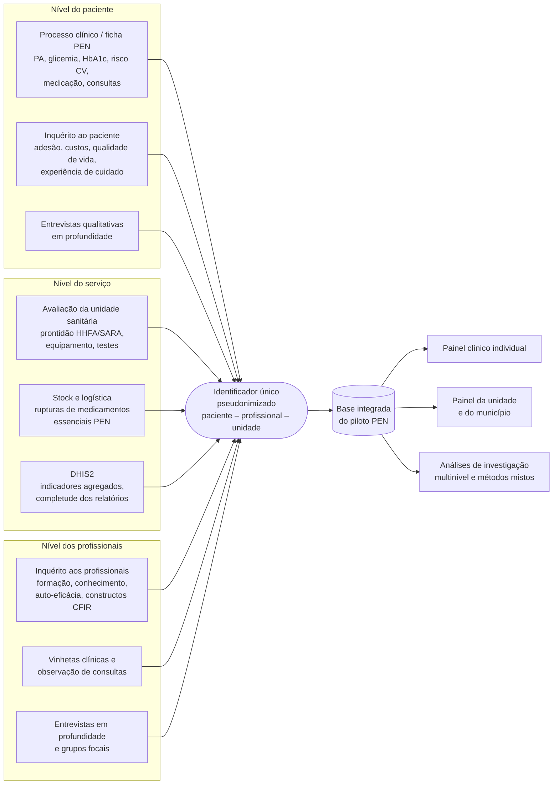
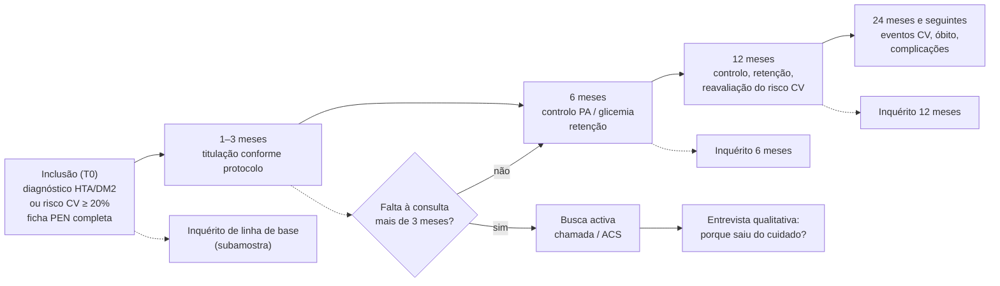
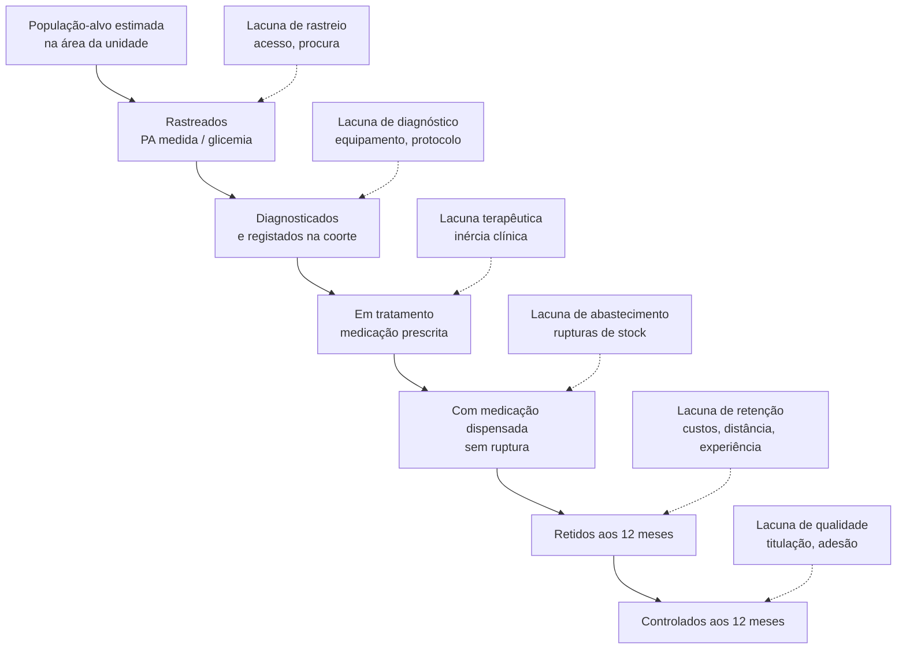
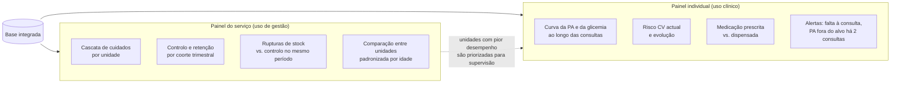
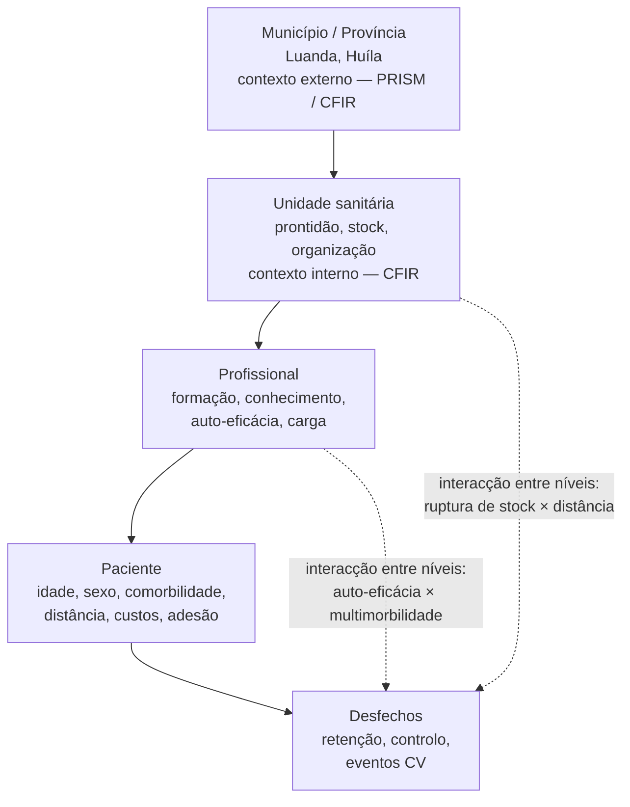
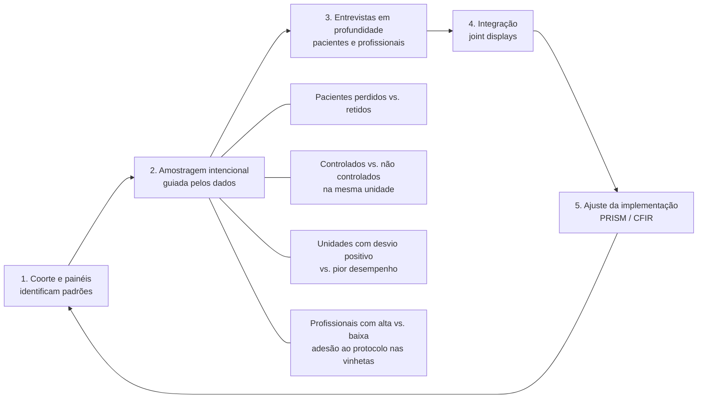
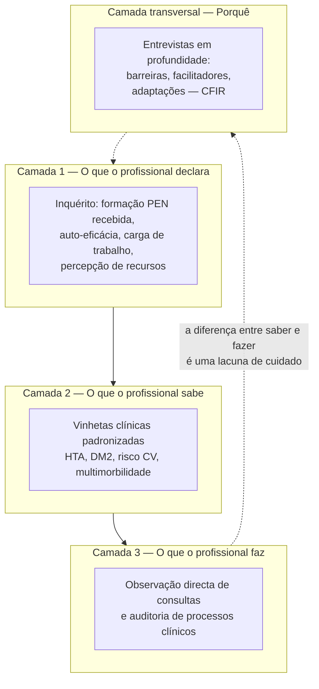
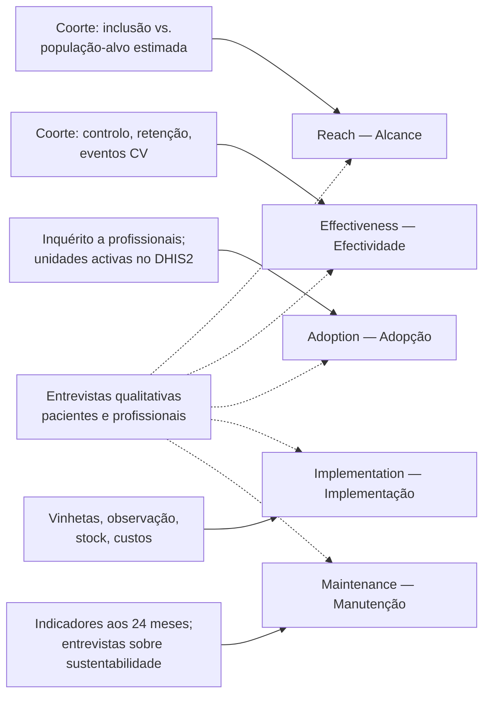

<!-- Importado de seguimento-coorte-dcnt-pen-angola.md. Pode editar aqui; não é preciso voltar à origem. -->

## 1. Ponto de partida: o que a literatura mostra

### 1.1 Panorama geral

As revisões sistemáticas dos últimos 10 anos sobre coortes com dados de registo electrónico (EHR) em risco cardiovascular, hipertensão (HTA) e diabetes tipo 2 (DM2) concentram-se em três temas:

- **Predição de risco CV com EHR e *machine learning*.** Os ganhos de discriminação em relação ao QRISK3, às *Pooled Cohort Equations* e ao SCORE são modestos, e a validação externa independente é pouca [1–3].
- **Validade dos dados registados.** Nos EHR europeus, os diagnósticos de AVC, síndrome coronária aguda e insuficiência cardíaca são em geral adequados para investigação. A validade é menor para a insuficiência cardíaca e para os subtipos de AVC [4].
- **Qualidade do relato.** A adesão às normas RECORD continua insuficiente nas coortes com dados do mundo real publicadas entre 2013 e 2021 [5, 6]. A emulação de ensaios-alvo com dados de rotina é promissora, mas ainda tem pouca expressão na diabetes [7, 8].

### 1.2 Países de baixa e média renda e África subsariana

- **Coortes de DCNT na África subsariana.** Foram identificadas 30 coortes em 18 países, 27% delas na África do Sul. A HTA é o desfecho mais estudado, seguida da obesidade e da diabetes. Os problemas mais frequentes são o baixo recrutamento e a baixa retenção. Nenhuma das coortes é angolana [9].
- **Cascata de cuidados da HTA nos países de baixa renda.** Em média, a consciência da doença é de 48%, o tratamento de 35% e o controlo de 16%. Os valores são mais baixos nos países de baixa renda e na África subsariana [10].
- **Retenção nos cuidados da DM2.** Nos estudos não randomizados, a retenção é de 68% nos cuidados secundários e terciários e de 40% nos cuidados primários [11].
- **Controlo glicémico.** A prevalência agregada de bom controlo é de 30%. Só 2 dos 74 estudos incluídos eram coortes [12].
- **Escores de risco CV.** Há evidência sobre a viabilidade e a aceitabilidade da sua implementação, mas a evidência sobre o uso sustentado é escassa e desfavorável [13].
- **EHR na região.** Os ganhos na gestão de dados estão documentados. O uso dos EHR para investigação clínica longitudinal continua incipiente [14].

### 1.3 Lacuna que orienta esta proposta

Na África subsariana, os "dados do mundo real" vêm sobretudo de revisões retrospectivas de processos em papel em hospitais terciários. Há poucas coortes de rotina nos CSP. Também há poucos estudos que liguem o percurso do paciente às condições do serviço (stock de medicamentos, equipa, formação) e à experiência de pacientes e profissionais. Esta é a lacuna que o piloto PEN em Luanda e Huíla pode preencher, desde que o registo seja desenhado desde o início como coorte.

---

## 2. Princípio de desenho

O registo clínico do piloto PEN cumpre duas funções ao mesmo tempo:

1. **Instrumento de cuidado.** É o processo clínico do paciente e a ficha de seguimento.
2. **Coorte prospectiva de rotina.** É a base de dados longitudinal, ligada por um identificador único, à qual se juntam dados da unidade sanitária, dos profissionais e de investigação qualitativa.

A unidade de análise é sempre dupla: **o paciente** (trajectória, controlo, eventos) e **o serviço** (oferta, prontidão, eficiência, lacunas). O interesse científico está na **interacção** entre os dois níveis. A pergunta-tipo é: que características do serviço modificam a probabilidade de um paciente com certo perfil ser retido e controlado?

---

## 3. Frentes de entrada de dados

**Figura 1 — Arquitectura das fontes de dados e ligação por identificador único**

**Quadro 1 — Frentes de entrada, periodicidade e responsáveis**

| Frente | Fonte | Conteúdo principal | Periodicidade | Quem recolhe |
|---|---|---|---|---|
| Processo clínico | Ficha PEN (papel → digital) | PA, glicemia/HbA1c, IMC, tabagismo, risco CV (cartas OMS), medicação, data da próxima consulta | Cada consulta | Equipa da unidade |
| Agregados de rotina | DHIS2 | Indicadores do Anexo 4.5 do PEN e das orientações OMS de monitorização | Trimestral / semestral | Estatística da unidade |
| Prontidão da unidade | HHFA leve / SARA | Equipamento, testes, protocolos, recursos humanos | Linha de base, 12 e 24 meses | Equipa de supervisão |
| Stock | Fichas de stock / SIGLUS ou equivalente | Dias de ruptura de anti-hipertensores, metformina, estatina, AAS, insulina | Mensal | Farmácia da unidade |
| Paciente (quantitativo) | Inquérito estruturado | Adesão, custos directos e indirectos, distância, EQ-5D-5L, experiência | Linha de base, 6 e 12 meses (subamostra) | Inquiridores |
| Paciente (qualitativo) | Entrevista semi-estruturada | Percurso, barreiras, significado da doença, confiança no serviço | Amostra intencional (ver Secção 6) | Investigadores |
| Profissionais (quantitativo) | Inquérito | Formação PEN, conhecimento, auto-eficácia, carga de trabalho, constructos CFIR | Linha de base e 12 meses | Investigadores |
| Profissionais (qualidade) | Vinhetas / observação | Adesão ao protocolo na prática (distância entre o que se sabe e o que se faz) | Linha de base e 12 meses | Supervisores treinados |
| Profissionais (qualitativo) | Entrevista em profundidade / grupo focal | Preparação percebida, lacunas, adaptações locais | Linha de base e 12 meses | Investigadores |

---

## 4. Seguimento do paciente: a coorte de rotina

### 4.1 Linha do tempo

**Figura 2 — Trajectória do paciente na coorte e pontos de inserção da investigação**

### 4.2 Definições operacionais mínimas

Estas definições têm de ser fixadas antes da inclusão do primeiro paciente.

- **Paciente activo:** pelo menos uma consulta nos últimos 3 meses.
- **Perdido de seguimento:** mais de 3 meses sem consulta após a data prevista, sem óbito nem transferência registados. Segue o critério das orientações OMS de monitorização de DNT com base nas unidades [15], "Indicadores opcionais", p. 14 ("Casos que ficam sem acompanhamento").
- **Controlo da PA:** PAS < 140 e PAD < 90 mmHg na última consulta do período, conforme o protocolo nacional. Segundo as mesmas orientações, os pacientes com estado de controlo desconhecido (faltosos, desistentes) ficam no denominador e contam como não controlados [15] (metadados do indicador de controlo da PA, secção de indicadores principais).
- **Controlo glicémico:** HbA1c < 7%, ou glicemia em jejum dentro do alvo do manual nacional quando não houver HbA1c. Quando há substituição, o método usado tem de ficar registado.
- **Análise por coorte de inclusão:** os pacientes são agrupados pelo trimestre de inclusão, e o controlo e a retenção são avaliados aos 6 e aos 12 meses. É a abordagem do pacote HEARTS — sistemas de monitorização [16].

### 4.3 Conjunto mínimo de variáveis (paciente)

Identificação pseudonimizada, sexo, idade, município de residência, distância à unidade, diagnóstico e data, PAS/PAD em cada consulta, glicemia e HbA1c, IMC, tabagismo, álcool, risco CV pelas cartas OMS/ISH 2019, creatinina/TFGe e albuminúria quando disponíveis, medicação prescrita (classe e dose), medicação dispensada, data da próxima consulta, desfecho (activo, transferido, perdido, óbito), eventos CV e hospitalizações.

A distinção entre **prescrito** e **dispensado** é crucial. É através dela que a ruptura de stock (nível do serviço) aparece na trajectória individual.

---

## 5. Do paciente ao serviço: oferta, eficiência e lacunas

### 5.1 Cascata de cuidados por unidade

**Figura 3 — Cascata de cobertura efectiva por unidade sanitária (adaptada de Tanahashi)**

Cada degrau calcula-se com dados da coorte, excepto o primeiro, que depende de estimativas populacionais (STEPS, projecções do INE). A perda entre degraus é a **lacuna de cuidado** e tem uma causa provável que se pode verificar com outras frentes de dados. Este modelo segue o quadro de cobertura efectiva de Tanahashi [17] e o de acesso centrado no paciente de Levesque et al. [18].

### 5.2 Indicadores de serviço derivados da coorte

| Dimensão | Indicador | Fonte |
|---|---|---|
| Oferta | Dias de ruptura de cada medicamento essencial PEN por trimestre; disponibilidade de esfigmomanómetro validado, glucómetro, tiras, HbA1c | Stock, HHFA [15, 19] |
| Prontidão | Índice de prontidão para DCNT (HHFA/SARA) | HHFA [19, 20] |
| Processo | Proporção de consultas com PA registada; proporção de pacientes com risco CV calculado; tempo até à intensificação terapêutica | Coorte |
| Eficiência | Consultas por paciente controlado; custo de medicamentos por paciente controlado; pacientes activos por profissional formado | Coorte + custos |
| Resultado | Controlo da PA e glicémico aos 6 e 12 meses, padronizado por idade; retenção aos 12 meses | Coorte, Anexo 4.5 do PEN (p. 75) [21] |
| Equidade | Os mesmos indicadores estratificados por sexo, idade, distância e município | Coorte |

### 5.3 Painéis de visualização

**Figura 4 — Dois painéis alimentados pela mesma base**

---

## 6. Estudar a interacção: desenho multinível e métodos mistos

### 6.1 Estrutura hierárquica

**Figura 5 — Estrutura multinível e interacções de interesse**

**Abordagens analíticas quantitativas:**

- Modelos de efeitos mistos (logísticos para controlo, de Poisson para consultas) com interceptos aleatórios por unidade e por profissional. O coeficiente de correlação intraclasse (ICC) e o *median odds ratio* quantificam a parte da variação do desfecho que se deve ao serviço [22].
- Termos de interacção entre níveis, por exemplo prontidão da unidade × características do paciente.
- Análise de sobrevivência (Kaplan-Meier, Cox com fragilidade por unidade) para o tempo até à perda de seguimento e até ao primeiro controlo.
- Séries temporais interrompidas para avaliar o efeito de acções do serviço (chegada de stock, formação) sobre o controlo agregado.
- Emulação de ensaio-alvo para perguntas comparativas sobre tratamento, quando os dados tiverem dimensão suficiente [8].

### 6.2 Integração com a investigação qualitativa

O desenho proposto é **explicativo sequencial**: os resultados quantitativos da coorte orientam a selecção intencional dos participantes das entrevistas [23, 24].

**Figura 6 — Ciclo de métodos mistos: da coorte às entrevistas e de volta**

**Exemplos de perguntas integradas:**

| Achado quantitativo | Pergunta qualitativa | Entrevistados |
|---|---|---|
| Unidade A tem stock estável e baixo controlo | Que práticas clínicas ou organizativas explicam o resultado? | Profissionais da unidade A; pacientes não controlados |
| Perdas de seguimento concentram-se em quem vive a mais de 5 km | Que custos e trade-offs levam à saída? | Pacientes perdidos e localizados por busca activa |
| Profissionais formados têm boas vinhetas mas pouca intensificação terapêutica | O que trava a intensificação na prática? | Profissionais formados |
| Unidade com desvio positivo (bom controlo apesar de pouca prontidão) | Que adaptações locais funcionam? | Equipa e pacientes da unidade |

### 6.3 Profissionais de saúde: preparação e lacunas

**Figura 7 — Avaliação da preparação dos profissionais em três camadas**

As vinhetas clínicas medem a qualidade do processo com validade comparável à de pacientes simulados e mais elevada do que a da auditoria de processos clínicos [25]. A diferença entre a camada 2 e a camada 3 identifica a distância entre o que se sabe e o que se faz. Essa distância explica-se a seguir com os constructos do CFIR: características dos indivíduos, contexto interno, processo de implementação [26, 27].

---

## 7. Alinhamento com RE-AIM, PRISM e CFIR

**Figura 8 — Mapa entre frentes de dados e dimensões RE-AIM**

| Dimensão | Pergunta | Frente principal | Frente complementar |
|---|---|---|---|
| Alcance (RE-AIM) | Quem entra na coorte e quem fica de fora? | Coorte vs. estimativa populacional | Entrevistas com não utilizadores ou perdidos |
| Efectividade (RE-AIM) | Melhora o controlo? Para quem? | Coorte (modelos multinível) | Inquérito ao paciente (qualidade de vida, custos) |
| Adopção (RE-AIM) | Que unidades e profissionais adoptam o protocolo? | Inquérito a profissionais, DHIS2 | Entrevistas com gestores |
| Implementação (RE-AIM) | Com que fidelidade e a que custo? | Vinhetas, observação, stock | Entrevistas sobre adaptações |
| Manutenção (RE-AIM) | Os resultados mantêm-se aos 24 meses? | Coorte longitudinal | Entrevistas sobre sustentabilidade |
| Contexto (PRISM / CFIR) | Que factores do contexto modificam os resultados? | HHFA, stock, dados municipais | Entrevistas em profundidade |

Referências dos enquadramentos: RE-AIM [28], PRISM [29] e guia iPRISM [30], CFIR [26, 27].

---

## 8. Ética, protecção de dados e governação

- **Aprovação ética:** Comité de Ética do MINSA. Consentimento informado separado para (a) uso secundário dos dados do processo clínico, (b) inquéritos e (c) entrevistas gravadas.
- **Protecção de dados:** cumprimento da Lei n.º 22/11, de 17 de Junho (Lei da Protecção de Dados Pessoais) [31]. A pseudonimização é feita na origem; a tabela de correspondência fica sob custódia de uma única entidade, separada da base de análise.
- **Ligação de dados:** um identificador único por paciente, profissional e unidade. Os dados qualitativos são ligados à base quantitativa só pelo código pseudonimizado.
- **Relato:** RECORD para a coorte de rotina [6], COREQ para os componentes qualitativos e GRAMMS para a integração de métodos mistos.
- **Devolução:** os painéis da unidade são partilhados todos os trimestres com as equipas, em linguagem acessível. Os resultados de investigação são apresentados primeiro às unidades participantes.

---

## 9. Questões em aberto para discussão

1. **Suporte do registo.** O registo será feito em papel com digitação central, num *tracker* DHIS2, ou noutra plataforma? Isto determina a viabilidade dos painéis individuais.
2. **Tamanho e duração.** Quantas unidades e quantos pacientes em Luanda e Huíla são necessários para estimar ICC e interacções entre níveis com precisão aceitável? É preciso fazer um cálculo de poder para modelos multinível.
3. **HbA1c.** A disponibilidade real nas unidades do piloto define se o controlo glicémico se mede por HbA1c ou por glicemia em jejum, com as limitações que isso implica.
4. **Desfechos duros.** Sem ligação a registos hospitalares e de óbito, os eventos CV e a mortalidade vão ficar subestimados. É preciso avaliar a viabilidade de fazer essa ligação.
5. **Custos.** Os custos para o paciente fazem parte do núcleo do inquérito ou de um estudo à parte?

---

## Referências

1. Machine learning based prediction models for cardiovascular disease risk using electronic health records data: systematic review and meta-analysis. *Eur Heart J Digit Health*. 2024. doi:10.1093/ehjdh/ztae080. https://www.ncbi.nlm.nih.gov/pmc/articles/PMC11750195/
2. Liu T, Krentz AJ, Huo Z, Ćurčin V. Opportunities and challenges of cardiovascular disease risk prediction for primary prevention using machine learning and electronic health records: a systematic review. *Rev Cardiovasc Med*. 2025;26(4):37443. doi:10.31083/RCM37443
3. Artificial intelligence in the risk prediction models of cardiovascular disease and development of an independent validation screening tool: a systematic review. https://www.springermedizin.de/de/artificial-intelligence-in-the-risk-prediction-models-of-cardiov/26702258
4. Validity of acute cardiovascular outcome diagnoses recorded in European electronic health records: a systematic review. *Clin Epidemiol*. 2020. doi:10.2147/CLEP.S265619
5. Evaluation of reporting quality of cohort studies using real-world data based on RECORD: systematic review. *BMC Med Res Methodol*. 2023. doi:10.1186/s12874-023-01960-2
6. Benchimol EI, Smeeth L, Guttmann A, et al. The REporting of studies Conducted using Observational Routinely-collected health Data (RECORD) statement. *PLoS Med*. 2015;12(10):e1001885.
7. Replicating cardiovascular outcome trials of medications used to treat type 2 diabetes using real-world data: a systematic review of observational studies. *medRxiv*. 2024. doi:10.1101/2024.11.28.24317099
8. Hernán MA, Robins JM. Using big data to emulate a target trial when a randomized trial is not available. *Am J Epidemiol*. 2016;183(8):758–64.
9. Mudie K, Tan MMJ, Kendall L, et al. Non-communicable diseases in sub-Saharan Africa: a scoping review of large cohort studies. *J Glob Health*. 2019;9(2):020409. doi:10.7189/jogh.09.020409
10. Lamloum D, Fassio F, Osetinsky B, Tediosi F. Care cascades for hypertension in low-income settings: a systematic review and meta-analysis. *Int J Public Health*. 2023;68:1606428. doi:10.3389/ijph.2023.1606428
11. Garrib A, Njim T, Adeyemi O, et al. Retention in care for type 2 diabetes management in Sub-Saharan Africa: a systematic review. *Trop Med Int Health*. 2023;28(4):248–61. doi:10.1111/tmi.13859
12. Fina Lubaki JP, et al. Glycaemic control among type 2 diabetes patients in sub-Saharan Africa from 2012 to 2022: a systematic review and meta-analysis. *Diabetol Metab Syndr*. 2022;14:134. doi:10.1186/s13098-022-00902-0
13. Implementation of cardiovascular risk prediction scores in sub-Saharan Africa: a scoping review. *Popul Med*. 2026;8(Suppl 1). https://www.populationmedicine.eu/Implementation-of-cardiovascular-risk-prediction-scores-in-sub-saharan-Africa-a-scoping,228146,0,2.html
14. A decade of designing and implementing electronic health records in Sub-Saharan Africa: a scoping review. *Glob Health Action*. 2025. doi:10.1080/16549716.2025.2492913
15. Organização Mundial da Saúde. *Orientações para a monitorização de doenças não transmissíveis com base nas unidades de saúde: enquadramento, indicadores e aplicação*. Genebra: OMS; 2022. ISBN 9789240069237. (Fig. 1, p. 5; indicadores opcionais, p. 14; avaliação de DRC em recém-diagnosticados com HTA, p. 18.) Documento disponível no projecto.
16. World Health Organization. *HEARTS technical package for cardiovascular disease management in primary health care: systems for monitoring*. Geneva: WHO; 2018. WHO/NMH/NVI/18.5.
17. Tanahashi T. Health service coverage and its evaluation. *Bull World Health Organ*. 1978;56(2):295–303.
18. Levesque JF, Harris MF, Russell G. Patient-centred access to health care: conceptualising access at the interface of health systems and populations. *Int J Equity Health*. 2013;12:18.
19. World Health Organization. *Harmonized health facility assessment (HHFA): comprehensive guide*. Geneva: WHO; 2022.
20. World Health Organization. *Service availability and readiness assessment (SARA): reference manual*. Geneva: WHO; 2015.
21. Organização Mundial da Saúde. *Pacote de intervenções essenciais para doenças não transmissíveis (WHO PEN) nos cuidados de saúde primários* (versão portuguesa). Genebra: OMS. Anexo 4.5, Tabela 1 — Indicadores para hipertensão e DCV, p. 75. Documento disponível no projecto.
22. Austin PC, Merlo J. Intermediate and advanced topics in multilevel logistic regression analysis. *Stat Med*. 2017;36(20):3257–77.
23. Creswell JW, Plano Clark VL. *Designing and conducting mixed methods research*. 3rd ed. Thousand Oaks: Sage; 2018.
24. Fetters MD, Curry LA, Creswell JW. Achieving integration in mixed methods designs — principles and practices. *Health Serv Res*. 2013;48(6 Pt 2):2134–56.
25. Peabody JW, Luck J, Glassman P, Dresselhaus TR, Lee M. Comparison of vignettes, standardized patients, and chart abstraction: a prospective validation study of 3 methods for measuring quality. *JAMA*. 2000;283(13):1715–22.
26. Damschroder LJ, Aron DC, Keith RE, et al. Fostering implementation of health services research findings into practice: a consolidated framework for advancing implementation science. *Implement Sci*. 2009;4:50.
27. Damschroder LJ, Reardon CM, Widerquist MAO, Lowery J. The updated Consolidated Framework for Implementation Research based on user feedback. *Implement Sci*. 2022;17:75.
28. Glasgow RE, Vogt TM, Boles SM. Evaluating the public health impact of health promotion interventions: the RE-AIM framework. *Am J Public Health*. 1999;89(9):1322–7.
29. Feldstein AC, Glasgow RE. A practical, robust implementation and sustainability model (PRISM) for integrating research findings into practice. *Jt Comm J Qual Patient Saf*. 2008;34(4):228–43.
30. *iPRISM and RE-AIM guidebook* (work in progress). https://re-aim.org/ Documento disponível no projecto.
31. República de Angola. Lei n.º 22/11, de 17 de Junho — Lei da Protecção de Dados Pessoais. *Diário da República*, I Série.
32. Herdman M, Gudex C, Lloyd A, et al. Development and preliminary testing of the new five-level version of EQ-5D (EQ-5D-5L). *Qual Life Res*. 2011;20(10):1727–36.
33. Sheikh A, Ombiro ON, Wurie HR, et al. Transforming hypertension management with digital technology: a retrospective cohort study in four sub-Saharan African countries. 2026. https://eprints.whiterose.ac.uk/id/eprint/241204/
34. Kruk ME, Gage AD, Arsenault C, et al. High-quality health systems in the Sustainable Development Goals era: time for a revolution. *Lancet Glob Health*. 2018;6(11):e1196–e1252.

---

*Nota: as referências 1–5, 7, 9–14 e 33 foram identificadas numa busca breve, não sistemática, com leitura dos resumos. Os valores numéricos citados na Secção 1 devem ser confirmados no texto integral antes de qualquer uso formal.*
